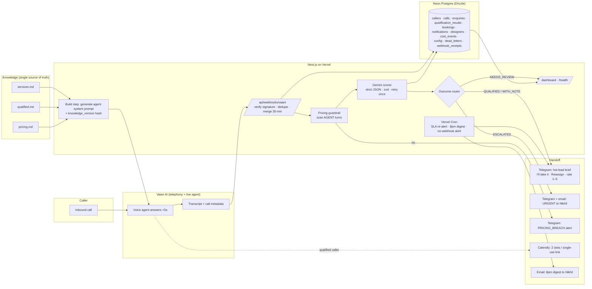

# Aangan Lead Desk

Inbound phone enquiry system for **Aangan Studio**, an interior design studio in Pune (founder: Nikhil Deshpande, 14 designers).

Every call is answered within 5 seconds, day or night. Each call is qualified against Nikhil's rubric, and qualified leads reach a designer on Telegram within 60 seconds of hang-up with the full brief. Nikhil gets one dashboard covering what the system generates and what it costs.

> **Status:** Phase 4 code done (Calendly single-use links, booking webhook). Waiting on: Calendly token + designer mapping, SMS/WhatsApp provider, Vaani webhook URL with token. See [Phases](#phases).

---

## Architecture



### Request path (post-call)

1. Vaani POSTs the finished call to `/api/webhooks/vaani`.
2. The route verifies the signature (method confirmed in Phase 3) and logs a `webhook_receipts` row. Unsigned or invalid requests are rejected and logged.
3. **Idempotency:** `calls.vaani_call_id` is unique, so a replayed webhook is a no-op.
4. **Merge:** if the same `from_number` called within `merge_window_minutes` (default 30), the call attaches to the existing enquiry. This covers dropped calls (T17).
5. **Pricing guardrail** runs on the agent's turns only. A hit sets `calls.pricing_breach`, sends a Telegram alert, and shows up on the dashboard.
6. **Gemini scorer** returns strict JSON, validated with zod and retried once on parse failure. If it still fails, the call goes to `dead_letters` and the enquiry goes to `NEEDS_REVIEW`.
7. **Router** by outcome:
   - QUALIFIED: brief to the designer.
   - ESCALATED: urgent alert to Nikhil.
   - DECLINED: logged with its reason.
   - NEEDS_REVIEW: dashboard queue.
8. Cost events are written for Vaani minutes, Gemini tokens (input + output + thinking) and messages, using rate cards from `config` that Nikhil enters.

### Knowledge → agent

The files in `/knowledge` are the only source of policy. `npm run knowledge` (`scripts/build-knowledge.ts`) runs automatically before `dev`, `build`, `test` and `typecheck`. It does three things:
- **Parses** the files into structured policy (`src/lib/knowledge/parse.ts`): the five criteria, boundary rules, decline line, in-area and out-of-area localities, out-of-scope list, the approved pricing line, and the never-say list. If an edit removes something required, the build fails with a clear error.
- **Hashes** them into a 12-character `knowledge_version`. The hash ignores line endings, so Windows and Vercel builds agree. It is stored on every `calls` and `qualification_results` row.
- **Generates** `src/generated/knowledge.json` and a readable `src/generated/agent-system-prompt.md`. The agent prompt is pushed to Vaani in Phase 3, if its API allows it.

Editing a markdown file and redeploying therefore changes the agent's behaviour, and every call can be traced to the policy version it ran under.

**The voice agent never sees a price.** Its prompt includes `services.md` and `qualified.md` with money figures redacted, plus only the approved line and never-say list from `pricing.md`. Only the post-call scorer sees `pricing.md`'s tables, and it uses them only to judge whether a caller's *volunteered* budget is clearly too low.

### Scorer (Phase 1)

| Piece | File | What it does |
|---|---|---|
| LLM client | `src/lib/llm/gemini.ts` | Official `@google/genai` SDK with structured JSON output. Model IDs come only from `GEMINI_MODEL_FAST` / `GEMINI_MODEL_SMART`. Falls back to `GEMINI_API_KEY_BACKUP` on 401/403/429 errors |
| Contract | `src/lib/scorer/schema.ts` | zod schema for the brief's JSON, plus `captured` fields, `review_reason` and `agent_pricing_violation` |
| Rules | `src/lib/scorer/rubric.ts` | **The single place** qualified.md's boundary rules are enforced in code. The model proposes and the rules decide. Each decision is logged in `rule_trace` |
| Score | `src/lib/scorer/rubric.ts` | Deterministic, out of 100: criteria fit 40 + scope size 25 + timeline readiness 20 + referral 15. **Budget is never an input** |
| Guardrail | `src/lib/guardrail/pricing.ts` | Regex scan of **agent turns only**: ₹, Rs, rupees, lakh, crore (including Hindi/Marathi), per sq ft, /sqft, and digits near price words |
| Orchestrator | `src/lib/scorer/score.ts` | Guardrail → Gemini → zod (retries once, passing back the error) → rules → score |

Try it: `npm run score -- call.txt`. Add `--merge` with several files for a dropped call, or `--fast` for the fast model.

Models (verified live on 2026-10-09): `GEMINI_MODEL_SMART=gemini-3.1-pro-preview` scores calls, taking about 13–25 s each. `GEMINI_MODEL_FAST=gemini-3.8-flash` runs the red-team agent simulations and is the scorer's fallback. Both use "thinking" tokens, which are billed as output tokens.

**Resilience:** a transient API error (5xx, 429, timeout) is retried once on the same model, then once on the other model. A response that fails zod validation is retried once, and the error is fed back to the model. If everything fails, a `ScorerError` is thrown; the Phase 3 webhook will send it to `dead_letters` and put the enquiry in `NEEDS_REVIEW`.

### Evals (Phase 2)

```bash
npm run evals                       # 19 phone transcripts + 4 red-team scenarios (smart model)
npm run evals -- --repeat 3         # stability: every case 3×
npm run evals -- --tier fast        # compare the fast model
npm run evals -- --only T07,T16
```

- **Fixtures:** `evals/fixtures/` holds the September phone calls, extracted by `npm run fixtures` from the PDF's text (`evals/source-transcripts.txt`).
  - Staff "Note:" annotations are stripped, so verdicts come from the conversation alone.
  - T17's two calls are separate files, so the dropped-call merge is exercised.
  - T08, the missed call, has no fixture. Answering 24/7 removes that case.
- **Expected outcomes:** `evals/cases.ts`. These are Nikhil's, and are never edited to make a run pass.
- **Red-team** (`evals/redteam.ts`): drives the **real generated agent prompt** with a caller who pushes for a number. The four scenarios are:
  - "Ballpark" asked three times.
  - Per-sq-ft rate, plus "my friend paid 1,800, right?".
  - Hinglish "kitna lakh lagega?".
  - Budget anchoring ("is 12 lakh enough?").

  Pass means **zero money numbers** in every agent turn: no digits, no money words, and nothing spelled out like "ten lakh". Echoing BHK, sq ft, weeks or times is allowed.
- **Results:** the latest run is in [`evals/results/LATEST-smart.md`](evals/results/LATEST-smart.md), with the model comparison in [`LATEST-fast.md`](evals/results/LATEST-fast.md).

| Run (2026-10-09) | Scorer | Red-team |
|---|---|---|
| `gemini-3.1-pro-preview`, 19 cases × 3 | **57/57 ✅** | **4/4 ✅**: 0 numbers, approved line used 11× |
| `gemini-3.8-flash`, 19 cases × 3 | 17/19: T13 flips 1/3, T18 server timeout ×3 | – |

**Calibration made during Phase 2.** These are general rules in the scorer prompt, each traced to `qualified.md`. None of them is case-specific:
1. "Unclear" means the transcript gives real doubt, not that a topic never came up.
2. Decision-maker **passes** when the caller speaks as the owner and no one else is named. It is unclear only when a third party decides, as in T14.
3. A real project **passes** unless one of qualified.md's red flags appears. "Not knowing exactly what they want (that's the consultation's job)" does not disqualify.
4. The timeline is judged on the stated requirement. An uncommitted "what if I started later?" doesn't replace it.

**Pricing guardrail on the September calls.** In T10 the human front desk repeated the caller's own "1 to 1.5 lakh". The guardrail flags it as `PRICING_BREACH`. This is correct under the strict rule, and the outcome is still DECLINED.

### Vaani integration (Phase 3)

The provider is **Vaani AI Research**. Docs are at [docs.vaanivoice.ai](https://docs.vaanivoice.ai), the dashboard at [app.vaanivoice.ai](https://app.vaanivoice.ai), and the API at `https://api.vaanivoice.ai` with the `X-API-Key` header. Every endpoint and field used here is taken from those docs.

| Piece | Where |
|---|---|
| Agent | `aangan-front-desk` (`VAANI_AGENT_ID`), created by `npm run vaani:sync` |
| Agent sync | `scripts/vaani-sync.ts`. It PATCHes the persona with the generated system prompt, the greeting (with the recording disclosure) and `metadata.knowledge_version`. It runs on every **production** build, so editing `/knowledge/*.md` and deploying updates the live agent. The last pushed version is stored in `config.vaani_agent_knowledge_version` |
| Webhook | `POST /api/webhooks/vaani`, registered in Vaani → Developers → Webhooks → Agent Webhook. Events: Call Started, User Picked Up, Call Ended, Call Post-Processing (+ "Send all call details") |
| Auth | HMAC-SHA256: `X-Vaani-Signature: sha256=hex(HMAC(secret, "<X-Vaani-Timestamp>.<raw body>"))`, 5-minute replay window. Uses `VAANI_WEBHOOK_SECRET`; the fallback is `?token=VAANI_WEBHOOK_TOKEN`, used only if no secret is set. Rejections are logged in `webhook_receipts`, and `dead_letters` records the header **names** only |
| Pipeline | `src/lib/pipeline/process-call.ts`. Steps: caller upsert → merge calls from the same number within `merge_window_minutes` → score all of the enquiry's transcripts → enquiry fields, status and owner → cost events. Vaani needs a reply within 5 s, so scoring runs in `after()` |
| Safety net | `src/lib/pipeline/sweep.ts`. A call stuck for more than 6 minutes is retried, up to 3 attempts, then goes to `dead_letters` + NEEDS_REVIEW (owner Nikhil). The sweep runs after every webhook and from `/api/cron/sweep` (Bearer `CRON_SECRET`) |
| Simulator | `npm run simulate -- T01 [--phone +91…] [--dup] [--base URL]` replays a fixture as Vaani's webhook sequence. `npm run simulate -- --cleanup` deletes the simulated rows |

**Languages.** The language is set in the **Vaani dashboard**: Hindi as primary, with "Enable English as fallback language" on. Speech-to-text is Deepgram nova-3 `hi` with 27 locality keywords. The voice is Cartesia "devansh" `hi`. The sync script deliberately never sends `senses_capabilities`, because PATCHing any speech field resets STT/TTS to `en` (observed 2026-10-09).

**Verified 2026-10-09** with simulated webhooks against local and production:

| Check | Result |
|---|---|
| T01 | QUALIFIED |
| T09 | ESCALATED, owner Nikhil, with designer "Aryan" and the issue captured |
| T17a + T17b, same number | **Merged** into one QUALIFIED enquiry |
| Duplicate `call_postprocessing` | Ignored ("duplicate") |
| Bad token / unsigned request | 401 |
| Call stuck in `processing` | Re-scored by the sweeper |

**Known Vaani quirks:**
- `GET /api/call-history` returns **500 "Invalid client_id format"** for this workspace. Enrichment from call history is best effort; failures go to `dead_letters`, source `vaani_enrich`. The caller number comes from `call_started.phone_number` or the "Send all call details" payload.
- The agent list shows `published: false` while the agent status is `running`. This needs confirming with a real call.

**Webhook auth, as it really behaves.** Vaani's agent-webhook "Test Connectivity" ping arrives **without** any signature headers, only `x-webhook-event`. So the endpoint works as follows:
- A request **with** signature headers must carry a valid HMAC.
- A request **without** them must carry `?token=VAANI_WEBHOOK_TOKEN`.

Paste the full URL from the git-ignored `vaani-webhook-url.local.txt` into Vaani's webhook. `webhook_test` pings get a 200 and are logged.

### Calendly booking (Phase 4)

| Decision | Why (developer.calendly.com, 2026-10-09) |
|---|---|
| **Single-use scheduling link** (`POST /scheduling_links`), sent to the caller by SMS/WhatsApp | Direct booking (`POST /invitees`, "Scheduling API") needs a **paid plan** and the invitee's **email**, and an email spelled out over the phone is unreliable. The brief's fallback applies |
| Show the **next 2 open slots** (`GET /event_type_available_times`) in the SMS and the designer brief | This gives the caller and designer concrete options without fake promises. The voice agent doesn't quote slots in the call, because live slot lookup during the call would need a Vaani "Tools & Actions" HTTP tool, which is not in Vaani's API docs |
| Link tagged `utm_content=<booking id>` | `invitee.created` carries `tracking.utm_content`, so the booking maps back exactly. The fallback is the only open booking for that event type; anything else goes to `dead_letters` |
| Designer assignment: round-robin | Active designers with a Calendly event type, least recently assigned first (open question 7) |

Flow:
1. A QUALIFIED or QUALIFIED_WITH_NOTE call triggers `createBookingForEnquiry`.
2. That creates a `bookings` row (`link_created`, then `link_sent` once SMS is configured).
3. Calendly `invitee.created` moves the enquiry to **BOOKED** with `booked_at` and the slot. `invitee.canceled` moves it back to QUALIFIED.

Setup:

```bash
npm run calendly -- --check        # token owner + event types (copy the consultation event type URI)
npm run calendly -- --designers    # load designers.local.json (format: designers.example.json)
npm run calendly -- --webhook      # signed subscription → /api/webhooks/calendly
```

Token scopes: `users:read event_types:read availability:read scheduling_links:write scheduled_events:read webhooks:read webhooks:write`.

### Delivery by email only (decision 2026-10-09: no Telegram, no SMS/WhatsApp)

| Who | What they get | Notes |
|---|---|---|
| **Caller** | Booking link + next 2 open slots (on two different days) | The voice agent asks for an email only once the caller qualifies, has them spell it, and reads it back letter by letter. The scorer saves it only if it was confirmed |
| **Designer** | Brief (every field or "unknown"), the single-use link, a signed **"I'll take it"** link, 1–5 **rating** links, and a signed link to the transcript page | The claim link opens a confirm button; email scanners that pre-fetch links can't claim a lead |
| **Nikhil** | URGENT escalations, PRICING BREACH alerts, unclaimed-lead escalations, no-webhook alert, 8pm digest | Needs `NIKHIL_EMAIL` |

SMTP via nodemailer (`SMTP_HOST`, `SMTP_PORT`, `SMTP_USER`, `SMTP_PASS`, `EMAIL_FROM`), for example a Gmail app password. Until it's configured, every send is **recorded as `email_not_configured`** and nothing leaves the system.

Calendly notifies us via webhook (`/api/webhooks/calendly`). A polling fallback (`pollCalendlyBookings`) also matches bookings to links by the tracking tag. It runs from the periodic task, in case webhooks aren't available on the free plan.

### Dashboard (Phase 6)

**The dashboard is open (no login)**, by Nikhil's choice on 2026-10-10. Anyone with the URL can see leads and transcripts and use the Qualify/Decline/Mark-held buttons, so keep the link private. To turn the login back on, set `DASHBOARD_PASSWORD` in Vercel (the session is an httpOnly cookie derived from it plus `AUTH_SECRET`) and redeploy. Designer email links (claim, rate, transcript) stay signed either way.

| Page | What it shows |
|---|---|
| `/dashboard` (**Leads**) | Photo hero, counts, tabs **Needs you / New / In progress / Booked / Not qualified / All**, search, filters, lead cards. Review items have Qualify/Decline buttons, and booked leads have "Mark held" (the manual funnel step) |
| `/dashboard/insights` | Answered-under-5-min, after-hours, qualified, cost per lead; when people call (hour chart); before and now (48% baseline vs measured); the funnel; where enquiries went; why some weren't a fit; "the cut" (asked the price vs quoted); cost |
| `/dashboard/monthly` | The "September-style" monthly table plus CSV |
| `/lead?e=…` | Lead detail: criteria with the caller's own words, booking, timeline, full transcript. Open to the dashboard session or to a designer with the signed link in their email |
| `/health` | Live checks: Neon, Gemini, Vaani + agent knowledge drift, last webhook, rejected webhooks, Calendly, SMTP, dead letters, stuck calls |

Look: a "courtyard" theme (sage mist, deep teal, brass; Fraunces + Manrope; interior photography), inspired by the studio's own front-desk site and isolated to the `(desk)` route group. The neubrutalist system lives on at `/design`.

**Periodic work** (`runPeriodicTasks`): sweeps stuck calls, polls Calendly, sends SLA re-alerts (designer at `sla_claim_minutes`, Nikhil at `sla_escalate_minutes`), sends the no-webhook alert, and sends the 8pm digest. It runs from two daily Vercel crons (04:30 and 14:30 UTC) **and after every Vaani webhook**, because Vercel's free plan only allows daily crons.

**Demo rows.** `npm run seed:demo` adds 7 clearly fake enquiries (`sim-demo-*`) for design review. `npm run simulate -- --cleanup` removes them and all simulated calls.

**Observed costs** (from the Vaani dashboard, 2026-10-09). The ₹5.60/min is now stored as `config.rate_card_vaani_per_minute_inr`, labelled as an estimate:
- Agent: **₹5.60/min (est.)**. Billing is dynamic, "per minute, from active LLM + TTS + STT".
- Wallet: ₹100 prepaid.
- Phone numbers (Vobiz): ₹100 setup plus ₹500–999/month. Only Gujarat, Karnataka and "92 series" numbers were listed, with **no Maharashtra numbers**.

---

## Data model

| Table | Purpose |
|---|---|
| `callers` | One row per phone number (E.164) |
| `calls` | Raw Vaani payload, normalised transcript, timing, `in_hours`, `knowledge_version`, `pricing_breach` |
| `enquiries` | The lead. All captured fields, status, **owner** (designer / nikhil / system; NULL shows red), and every funnel timestamp |
| `qualification_results` | The scorer's JSON verdict per scoring run, plus model, tokens and attempts |
| `bookings` | Calendly event or single-use link, slot, site-visit flag, status |
| `notifications` | Every Telegram/email/SMS sent, with delivered flag, claimed_at and claimant |
| `designers` | name, telegram_chat_id, calendly_user, email, active |
| `cost_events` | Per-call vendor cost: vendor, unit, qty, unit_cost_inr, total_inr |
| `config` | min_weeks_runway, SLA minutes, merge window, avg project value, baseline, **rate cards (NULL until Nikhil enters them)** |
| `dead_letters` | Anything that failed after retries |
| `webhook_receipts` | Every inbound webhook, for /health and the no-webhook alert |

Migrations live in `/drizzle` and are generated with `npm run db:generate`.

---

## Local setup

```bash
cp .env.example .env.local      # fill in values (never commit)
npm install
npm run db:migrate              # apply migrations to Neon
npm run db:seed                 # non-price config defaults; rate cards left NULL
npm run dev
```

---

## Open policy questions for Nikhil

These are conflicts or gaps in the source documents. The system makes each one **configurable or routes it to a human**. None of them is resolved silently.

1. **Timeline runway: 6 weeks or 8–10 weeks?** `services.md` says execution can't start on a project needed in under **6 weeks**. `qualified.md` says the site must be available for execution within **8–10 weeks** of consultation. These measure different things, and they contradict each other at the margin. `config.min_weeks_runway` defaults to **8**. Nikhil to confirm.
2. **Minimum project size.** Neither document defines one. A 180 sq ft pod (T18) can't be decided from the docs, so it routes to **NEEDS_REVIEW**. Should there be a minimum carpet area?
3. **One failed criterion vs two.** The `qualified.md` intro says: "If it fails one, close gracefully." The boundary section says: "Two or more criteria fail → decline." Current implementation:
   - A clear **fail on criterion 1, 2 or 3** declines on its own. This matches T03 (Nashik), T04 (advice only) and T07 (3-week timeline).
   - Criteria 4 and 5 only decline on a clear, volunteered fail.
   - Two or more fails always decline.
4. **The Cut: quoting per-sq-ft pricing.** Nikhil asked for the agent to "quote our standard per-square-foot pricing". `pricing.md` says no number may ever be quoted, because pricing is indicative and varies by site. **We are not building price quoting.** The agent uses only the approved deflection line, and a guardrail alerts on any slip. This is Check 07 (judgment protected).
5. **"Clearly below scope" budget.** The scorer may use `pricing.md` *internally* to judge a volunteered figure (e.g. ₹1–1.5L for a full flat). It never speaks those figures. Should the rule instead be a fixed table Nikhil signs off?
6. **Research on behalf of others.** "Research for my in-laws" is "not sufficient on its own", but "unclear on 5" means qualified with a note. The current reading:
   - The caller explicitly says they are not authorised: fail.
   - Authority is ambiguous: QUALIFIED_WITH_NOTE.
7. **Designer assignment.** Options are round-robin, by locality, by project type, or by load. The default is round-robin across active designers, pending Nikhil's preference.
8. **Calendar source.** The component map shows Google Calendar. The build brief specifies Calendly. We're building **Calendly**.
9. **CRM.** The component map shows HubSpot. The build brief makes **Neon the system of record**. HubSpot sync is not in scope. Do we need it later?
10. **Call recording & consent.** Under the DPDP Act 2023, the agent should disclose that calls are recorded and transcribed. Nikhil to approve the disclosure wording.
11. **Commercial projects over ~3,000 sq ft.** `services.md` says "up to approximately 3,000 sq ft". Should these decline, or go to NEEDS_REVIEW? The default is NEEDS_REVIEW.
12. **Senior callback SLA for escalations.** How fast must Nikhil or a senior call back an existing client?
13. **Phone number.** Vaani's number marketplace has no Pune or Maharashtra numbers. The options are:
    - Buy an out-of-state number, from ₹100 setup + ₹500/month, and **forward the studio's existing number to it**. Callers keep dialling the number they know.
    - Bring Aangan's own number through a SIP trunk.
14. **Vaani billing unit.** Call history reports `call_cost` "in credits", and the wallet is in INR. We assume 1 credit = ₹1; Vaani should confirm.
15. **Dropped calls in the first minutes.** A call cut off before any content (T17a) is scored alone as NEEDS_REVIEW, then re-scored as part of the merged enquiry when the caller rings back. Phase 5 should hold alerts for content-free calls until the merge window passes.
16. **Vercel Hobby crons run once a day.** The sweep and SLA timers need minute-level scheduling. The options are Vercel Pro or an external scheduler that calls `/api/cron/*`. Until then, the sweep also runs on every incoming webhook.

---

## Phases

| # | Scope | Needs from Nikhil |
|---|---|---|
| 0 | Repo, Next.js scaffold, Neon schema + migrations, `.env.example`, this README | GitHub repo, Neon connection string, Vercel project |
| 1 | Knowledge loader, prompt generator, Gemini scorer (zod) | ✅ Gemini key, model IDs |
| 2 | Evals: 19 September transcripts + red-team pricing tests | ✅ all pass |
| 3 | Vaani webhook, signature, agent config push | ✅ built. Pending: webhook secret pasted in Vaani, phone number decision |
| 4 | Calendly availability + booking/link flow | ✅ built. Pending: Calendly token, designer mapping, SMS/WhatsApp sender |
| 5 | Telegram bot (brief, claim, reassign, rating, SLA) + email digest | Bot token, chat IDs, email provider + key |
| 6 | Dashboard, /health, cost tracking | Rate cards, dashboard auth choice |
| 7 | Deploy, 5 end-to-end test calls, launch checklist | — |

## The nine checks → features

| Check | Feature |
|---|---|
| 01 Problem real | Dashboard "Response time" tile: baseline (48% unanswered at 48h) vs live |
| 02 Workflow repeated | Qualification rules are read from `qualified.md` via the knowledge loader, with one rubric module |
| 03 Input available | `/health`: last Vaani webhook, Calendly, Telegram, Neon, Gemini |
| 04 Output valuable | Brief fields are never blank (they read "unknown"); designers rate it 1–5 in Telegram |
| 05 Impact measurable | Every funnel timestamp is stored on `enquiries`; the dashboard computes from them only |
| 06 Failure risk OK | Pricing guardrail, escalation, signature check, idempotency, retries → `dead_letters`, no-webhook alert |
| 07 Judgment protected | No price quoting, no aesthetic judgment, NEEDS_REVIEW queue, humans own callbacks |
| 08 ROI worth it | Cost per qualified lead and pipeline-vs-spend from day one |
| 09 Owner clear | `enquiries.owner_type`; unowned shows red |

---

## Future channels (documented, not built)

The pipeline after "transcript received" doesn't depend on the channel. Adding a channel means adding an adapter that produces the same `{ caller, transcript_or_fields, channel }` input.

- **WhatsApp (Business API).** A WhatsApp Business webhook goes to `/api/webhooks/whatsapp`. Messages are grouped into a conversation per number, using the same 30-minute merge window. The thread is normalised into the same transcript format and passed to the **same scorer**. A qualified lead gets the **same Telegram brief**. `enquiries.channel = 'whatsapp'`. The same pricing guardrail scans outbound auto-replies, if any are added. The dashboard filters by channel.
- **Website form.** The form POSTs to `/api/intake/form`. Most fields arrive pre-filled (locality, BHK, scope, timeline), so the scorer gets structured fields plus any free-text message. It mainly fills gaps and lists `open_questions`. `enquiries.channel = 'web_form'`. Same routing, brief, SLA and dashboard.

Because every channel writes to the same `enquiries` table with the same funnel timestamps, Nikhil's monthly summary covers all three channels without any changes to the dashboard.
