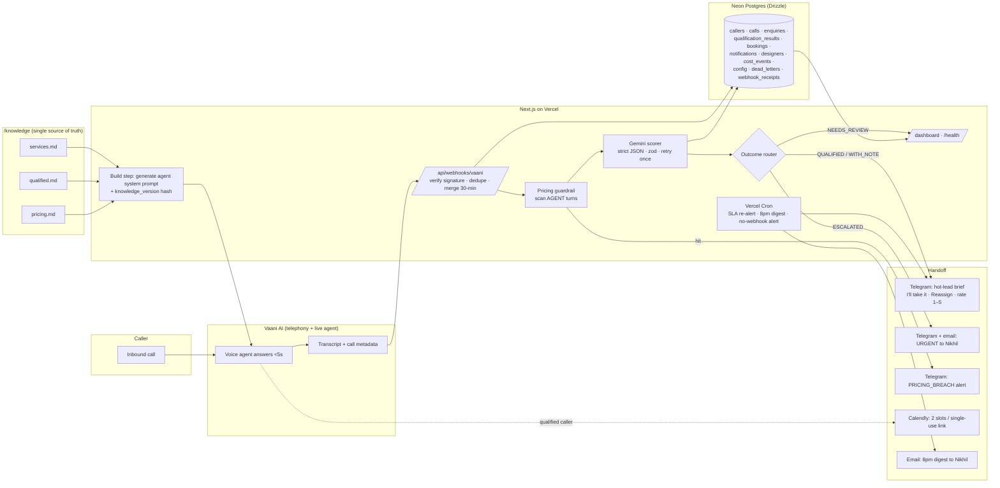

# Aangan Lead Desk

Inbound phone enquiry system for **Aangan Studio**, an interior design studio in Pune (founder: Nikhil Deshpande, 14 designers).

Every call is answered within 5 seconds, day or night. Each call is qualified against Nikhil's rubric, and qualified leads reach a designer on Telegram within 60 seconds of hang-up with the full brief. Nikhil gets one dashboard covering what the system generates and what it costs.

> **Status:** Phase 1 done (knowledge loader, prompt generator, Gemini scorer, pricing guardrail). See [Phases](#phases).

---

## Architecture



### Request path (post-call)

1. Vaani POSTs the finished call to `/api/webhooks/vaani`.
2. The route verifies the signature (method confirmed in Phase 3) and logs a `webhook_receipts` row. Unsigned or invalid requests are rejected and logged.
3. **Idempotency:** `calls.vaani_call_id` is unique, so a replayed webhook is a no-op.
4. **Merge:** if the same `from_number` called within `merge_window_minutes` (default 30), the call attaches to the existing enquiry. This covers dropped calls (T17).
5. **Pricing guardrail** runs on the agent's turns only. A hit sets `calls.pricing_breach`, sends a Telegram alert, and shows up on the dashboard.
6. **Gemini scorer** returns strict JSON, validated with zod and retried once on parse failure. If it still fails, the call goes to `dead_letters` and the enquiry goes to `NEEDS_REVIEW`.
7. **Router** by outcome:
   - QUALIFIED: brief to the designer.
   - ESCALATED: urgent alert to Nikhil.
   - DECLINED: logged with its reason.
   - NEEDS_REVIEW: dashboard queue.
8. Cost events are written for Vaani minutes, Gemini tokens (input + output + thinking) and messages, using rate cards from `config` that Nikhil enters.

### Knowledge → agent

The files in `/knowledge` are the only source of policy. `npm run knowledge` (`scripts/build-knowledge.ts`) runs automatically before `dev`, `build`, `test` and `typecheck`. It does three things:
- **Parses** the files into structured policy (`src/lib/knowledge/parse.ts`): the five criteria, boundary rules, decline line, in-area and out-of-area localities, out-of-scope list, the approved pricing line, and the never-say list. If an edit removes something required, the build fails with a clear error.
- **Hashes** them into a 12-character `knowledge_version`. The hash ignores line endings, so Windows and Vercel builds agree. It is stored on every `calls` and `qualification_results` row.
- **Generates** `src/generated/knowledge.json` and a readable `src/generated/agent-system-prompt.md`. The agent prompt is pushed to Vaani in Phase 3, if its API allows it.

Editing a markdown file and redeploying therefore changes the agent's behaviour, and every call can be traced to the policy version it ran under.

**The voice agent never sees a price.** Its prompt includes `services.md` and `qualified.md` with money figures redacted, plus only the approved line and never-say list from `pricing.md`. Only the post-call scorer sees `pricing.md`'s tables, and it uses them only to judge whether a caller's *volunteered* budget is clearly too low.

### Scorer (Phase 1)

| Piece | File | What it does |
|---|---|---|
| LLM client | `src/lib/llm/gemini.ts` | Official `@google/genai` SDK with structured JSON output. Model IDs come only from `GEMINI_MODEL_FAST` / `GEMINI_MODEL_SMART`. Falls back to `GEMINI_API_KEY_BACKUP` on 401/403/429 errors |
| Contract | `src/lib/scorer/schema.ts` | zod schema for the brief's JSON, plus `captured` fields, `review_reason` and `agent_pricing_violation` |
| Rules | `src/lib/scorer/rubric.ts` | **The single place** qualified.md's boundary rules are enforced in code. The model proposes and the rules decide. Each decision is logged in `rule_trace` |
| Score | `src/lib/scorer/rubric.ts` | Deterministic, out of 100: criteria fit 40 + scope size 25 + timeline readiness 20 + referral 15. **Budget is never an input** |
| Guardrail | `src/lib/guardrail/pricing.ts` | Regex scan of **agent turns only**: ₹, Rs, rupees, lakh, crore (including Hindi/Marathi), per sq ft, /sqft, and digits near price words |
| Orchestrator | `src/lib/scorer/score.ts` | Guardrail → Gemini → zod (retries once, passing back the error) → rules → score |

Try it: `npm run score -- call.txt`. Add `--merge` with several files for a dropped call, or `--fast` for the fast model.

Models (verified live on 2026-10-09): `GEMINI_MODEL_SMART=gemini-3.1-pro-preview` (about 18–25 s per call) and `GEMINI_MODEL_FAST=gemini-3.8-flash` (about 16 s). Both include "thinking" tokens, which are billed as output tokens. Phase 2 evals will decide which one the scorer uses.

---

## Data model

| Table | Purpose |
|---|---|
| `callers` | One row per phone number (E.164) |
| `calls` | Raw Vaani payload, normalised transcript, timing, `in_hours`, `knowledge_version`, `pricing_breach` |
| `enquiries` | The lead. All captured fields, status, **owner** (designer / nikhil / system; NULL shows red), and every funnel timestamp |
| `qualification_results` | The scorer's JSON verdict per scoring run, plus model, tokens and attempts |
| `bookings` | Calendly event or single-use link, slot, site-visit flag, status |
| `notifications` | Every Telegram/email/SMS sent, with delivered flag, claimed_at and claimant |
| `designers` | name, telegram_chat_id, calendly_user, email, active |
| `cost_events` | Per-call vendor cost: vendor, unit, qty, unit_cost_inr, total_inr |
| `config` | min_weeks_runway, SLA minutes, merge window, avg project value, baseline, **rate cards (NULL until Nikhil enters them)** |
| `dead_letters` | Anything that failed after retries |
| `webhook_receipts` | Every inbound webhook, for /health and the no-webhook alert |

Migrations live in `/drizzle` and are generated with `npm run db:generate`.

---

## Local setup

```bash
cp .env.example .env.local      # fill in values (never commit)
npm install
npm run db:migrate              # apply migrations to Neon
npm run db:seed                 # non-price config defaults; rate cards left NULL
npm run dev
```

---

## Open policy questions for Nikhil

These are conflicts or gaps in the source documents. The system makes each one **configurable or routes it to a human**. None of them is resolved silently.

1. **Timeline runway: 6 weeks or 8–10 weeks?** `services.md` says execution can't start on a project needed in under **6 weeks**. `qualified.md` says the site must be available for execution within **8–10 weeks** of consultation. These measure different things, and they contradict each other at the margin. `config.min_weeks_runway` defaults to **8**. Nikhil to confirm.
2. **Minimum project size.** Neither document defines one. A 180 sq ft pod (T18) can't be decided from the docs, so it routes to **NEEDS_REVIEW**. Should there be a minimum carpet area?
3. **One failed criterion vs two.** The `qualified.md` intro says: "If it fails one, close gracefully." The boundary section says: "Two or more criteria fail → decline." Current implementation:
   - A clear **fail on criterion 1, 2 or 3** declines on its own. This matches T03 (Nashik), T04 (advice only) and T07 (3-week timeline).
   - Criteria 4 and 5 only decline on a clear, volunteered fail.
   - Two or more fails always decline.
4. **The Cut: quoting per-sq-ft pricing.** Nikhil asked for the agent to "quote our standard per-square-foot pricing". `pricing.md` says no number may ever be quoted, because pricing is indicative and varies by site. **We are not building price quoting.** The agent uses only the approved deflection line, and a guardrail alerts on any slip. This is Check 07 (judgment protected).
5. **"Clearly below scope" budget.** The scorer may use `pricing.md` *internally* to judge a volunteered figure (e.g. ₹1–1.5L for a full flat). It never speaks those figures. Should the rule instead be a fixed table Nikhil signs off?
6. **Research on behalf of others.** "Research for my in-laws" is "not sufficient on its own", but "unclear on 5" means qualified with a note. The current reading:
   - The caller explicitly says they are not authorised: fail.
   - Authority is ambiguous: QUALIFIED_WITH_NOTE.
7. **Designer assignment.** Options are round-robin, by locality, by project type, or by load. The default is round-robin across active designers, pending Nikhil's preference.
8. **Calendar source.** The component map shows Google Calendar. The build brief specifies Calendly. We're building **Calendly**.
9. **CRM.** The component map shows HubSpot. The build brief makes **Neon the system of record**. HubSpot sync is not in scope. Do we need it later?
10. **Call recording & consent.** Under the DPDP Act 2023, the agent should disclose that calls are recorded and transcribed. Nikhil to approve the disclosure wording.
11. **Commercial projects over ~3,000 sq ft.** `services.md` says "up to approximately 3,000 sq ft". Should these decline, or go to NEEDS_REVIEW? The default is NEEDS_REVIEW.
12. **Senior callback SLA for escalations.** How fast must Nikhil or a senior call back an existing client?

---

## Phases

| # | Scope | Needs from Nikhil |
|---|---|---|
| 0 | Repo, Next.js scaffold, Neon schema + migrations, `.env.example`, this README | GitHub repo, Neon connection string, Vercel project |
| 1 | Knowledge loader, prompt generator, Gemini scorer (zod) | ✅ Gemini key, model IDs |
| 2 | Evals: 19 September transcripts + red-team pricing tests | Transcript PDF (provided) |
| 3 | Vaani webhook, signature, agent config push | Vaani docs, keys, rate card, language support |
| 4 | Calendly availability + booking/link flow | Calendly token, designer mapping, SMS/WhatsApp sender |
| 5 | Telegram bot (brief, claim, reassign, rating, SLA) + email digest | Bot token, chat IDs, email provider + key |
| 6 | Dashboard, /health, cost tracking | Rate cards, dashboard auth choice |
| 7 | Deploy, 5 end-to-end test calls, launch checklist | — |

## The nine checks → features

| Check | Feature |
|---|---|
| 01 Problem real | Dashboard "Response time" tile: baseline (48% unanswered at 48h) vs live |
| 02 Workflow repeated | Qualification rules are read from `qualified.md` via the knowledge loader, with one rubric module |
| 03 Input available | `/health`: last Vaani webhook, Calendly, Telegram, Neon, Gemini |
| 04 Output valuable | Brief fields are never blank (they read "unknown"); designers rate it 1–5 in Telegram |
| 05 Impact measurable | Every funnel timestamp is stored on `enquiries`; the dashboard computes from them only |
| 06 Failure risk OK | Pricing guardrail, escalation, signature check, idempotency, retries → `dead_letters`, no-webhook alert |
| 07 Judgment protected | No price quoting, no aesthetic judgment, NEEDS_REVIEW queue, humans own callbacks |
| 08 ROI worth it | Cost per qualified lead and pipeline-vs-spend from day one |
| 09 Owner clear | `enquiries.owner_type`; unowned shows red |

---

## Future channels (documented, not built)

The pipeline after "transcript received" doesn't depend on the channel. Adding a channel means adding an adapter that produces the same `{ caller, transcript_or_fields, channel }` input.

- **WhatsApp (Business API).** A WhatsApp Business webhook goes to `/api/webhooks/whatsapp`. Messages are grouped into a conversation per number, using the same 30-minute merge window. The thread is normalised into the same transcript format and passed to the **same scorer**. A qualified lead gets the **same Telegram brief**. `enquiries.channel = 'whatsapp'`. The same pricing guardrail scans outbound auto-replies, if any are added. The dashboard filters by channel.
- **Website form.** The form POSTs to `/api/intake/form`. Most fields arrive pre-filled (locality, BHK, scope, timeline), so the scorer gets structured fields plus any free-text message. It mainly fills gaps and lists `open_questions`. `enquiries.channel = 'web_form'`. Same routing, brief, SLA and dashboard.

Because every channel writes to the same `enquiries` table with the same funnel timestamps, Nikhil's monthly summary covers all three channels without any changes to the dashboard.
